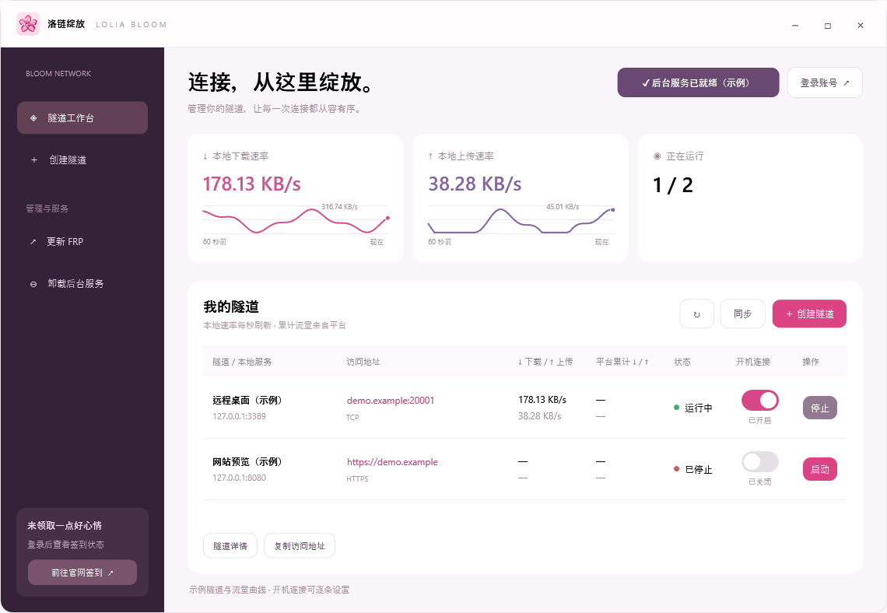
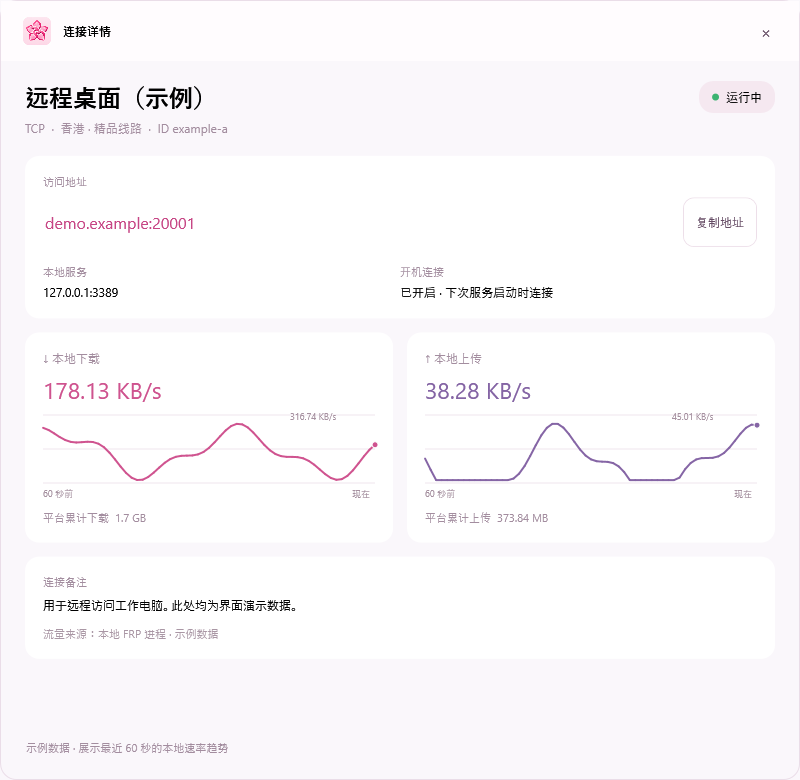
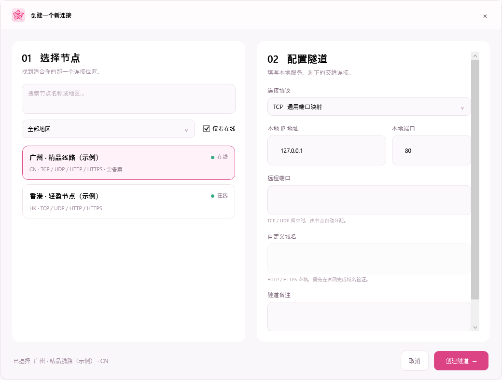

# 🌸 Lolia Bloom · 洛链绽放

A pink-themed community client for Lolia FRP, with a Windows desktop app and a Linux Docker web manager.

[English](README.md) | [简体中文](README.zh-CN.md)

**Live traffic dashboard**



**Connection details**



**Create a tunnel**



Screenshots are rendered by the Windows client using example tunnels and traffic data.

## Features

- **Refined workspace** — custom title bar, searchable node cards, region and online filters, and one-click address copying.

- **Independent FRP updates** — download official releases, verify SHA256, restore running tunnels and roll back on failure.

- **Cloud tunnel creation** — select a node and create TCP, UDP, HTTP or HTTPS tunnels.
- **Saved login** — click Login to authorize with the official website; OAuth PKCE, encrypted credentials and automatic token refresh.
- **Local network rates** — live 60-second upload/download charts, refreshed every second with per-process Windows ETW counters. Excludes loopback and backend traffic; includes FRP transport overhead. Platform totals remain separate.
- **Website check-in** — open the official dashboard to check in and view your check-in status.

- **Pink interface** — a clean tunnel list with per-tunnel start and stop buttons.
- **Tunnel details** — a live card view of rates, traffic trends, platform totals, startup state and copyable access addresses.
- **Background service** — keep tunnel processes running after closing the window.
- **One-click service installation** — install or remove the Windows Service from the app with administrator approval.
- **Start with Windows** — independent capsule switches for each tunnel; settings survive cloud sync and service restarts, with retries when the initial connection fails.
- **Single EXE for Windows x64** — run one file; the included runtime is prepared automatically. A ZIP alternative is also available.
- **Linux web manager** — deploy with Docker Compose, sign in to the management page, sync cloud tunnels, start or stop tunnels individually, set per-tunnel startup behavior, and install verified FRP updates.
- **Docker traffic charts** — show the last 60 seconds of container-interface traffic, including web management traffic; official cumulative tunnel traffic is displayed separately.

[Download Windows x64](https://github.com/kkbbzjh/LoliaBloom/releases/latest)

### Docker deployment

Use a Linux host or NAS with Docker Compose. Replace `192.168.1.20` with its LAN address. On the first publication, open [GHCR package settings](https://github.com/users/kkbbzjh/packages/container/package/loliabloom) and set visibility to **Public** so Docker can pull the image without signing in.

```bash
mkdir -p ~/loliabloom && cd ~/loliabloom
curl -fsSLO https://raw.githubusercontent.com/kkbbzjh/LoliaBloom/main/compose.yaml
curl -fsSLO https://raw.githubusercontent.com/kkbbzjh/LoliaBloom/main/.env.example
cp .env.example .env
openssl rand -base64 32
```

Put the generated random value in `.env` as `LOLIABLOOM_ADMIN_PASSWORD`, set `LOLIABLOOM_PUBLIC_URL=http://192.168.1.20:8080`, then run:

```bash
docker compose pull
docker compose up -d
```

Open `http://192.168.1.20:8080` and enter the admin password. For internet access, configure an HTTPS reverse proxy and set `LOLIABLOOM_PUBLIC_URL` to its HTTPS address.

Cloud authorization requires the OAuth app to allow the exact callback `{LOLIABLOOM_PUBLIC_URL}/auth/callback`. If the default public Client ID does not allow that address, authorization will be rejected; configure a Client ID with that callback registered in `LOLIA_OAUTH_CLIENT_ID`. `LOLIABLOOM_OAUTH_REDIRECT_URL` can override the full callback URL.

For maintenance, use `docker compose logs -f` to view logs, `docker compose pull && docker compose up -d` to update, and `docker compose down` to stop. Tunnel and login data persist in the `loliabloom-data` Docker volume.

Lolia Bloom is an unofficial community client, not affiliated with Lolia FRP.

## License and commercial authorization

[](LICENSE)

Lolia Bloom's original code and assets are source-available under the [Lolia Bloom Noncommercial License 1.0](LICENSE). Noncommercial use, modification and distribution are permitted under its terms. **All commercial purposes, including internal business use, require prior separate written authorization from the copyright holder.** Free access to the program does not grant commercial rights. This is not an OSI-approved open-source license.

For commercial authorization, [contact kkbbzjh through a GitHub issue](https://github.com/kkbbzjh/LoliaBloom/issues/new?title=Commercial%20authorization%20request). Keep credentials and confidential information out of public requests. The English LICENSE text governs; this paragraph is a summary.

Third-party components retain their own licenses. In particular, the bundled FRP engine remains under Apache License 2.0; see [third-party notices](THIRD-PARTY-NOTICES.md).
