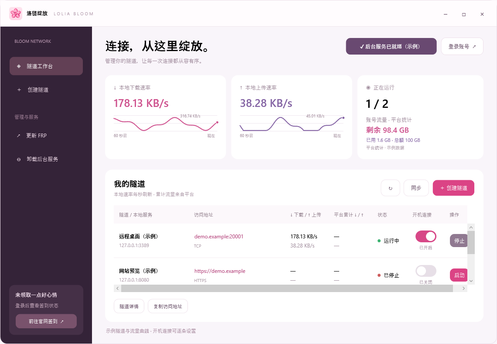
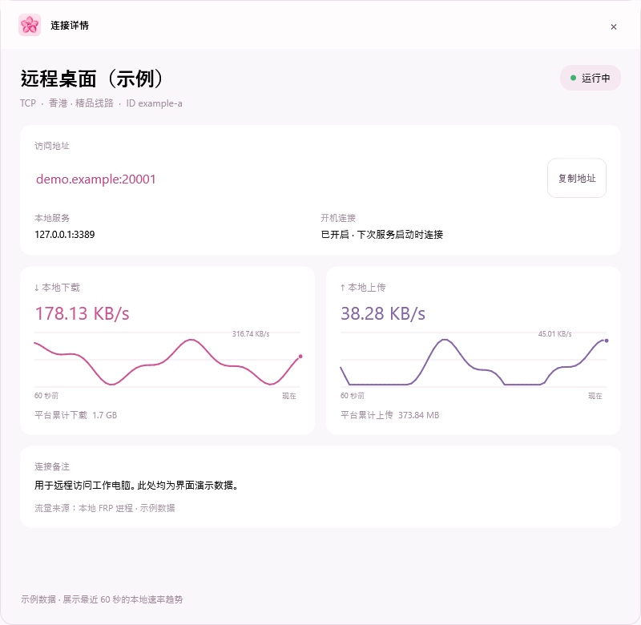
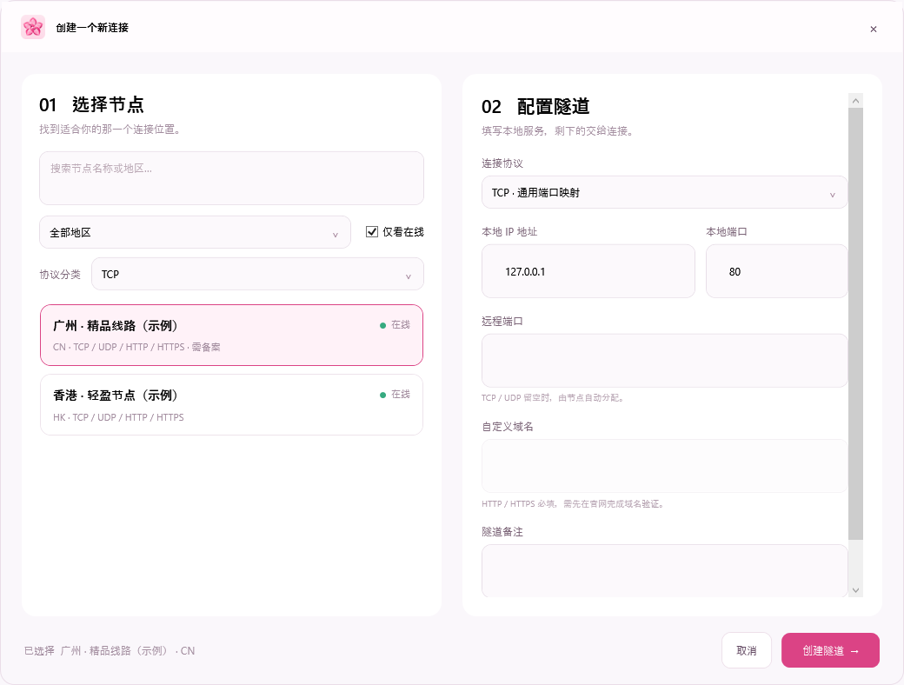

# 🌸 Lolia Bloom（洛链绽放）

洛链映射（Lolia FRP）的粉色主题社区客户端，提供 Windows 桌面版和 Linux Docker 网页管理版。

[English](README.md) | [简体中文](README.zh-CN.md)

**实时流量工作台**



**连接详情**



**创建隧道**



截图由 Windows 客户端实际渲染，隧道与流量均为示例数据。

## 功能特色

- **软件内更新（Windows）**：自动检查正式版，点击后下载、校验 SHA256 并启动新版；新版保存在当前单文件 EXE 同目录，显示进度、支持取消，新版确认窗口就绪后退出旧版，保留登录、隧道设置和签到计时。

- **精致工作台**：自定义标题栏、节点卡片、名称与地区筛选、在线状态筛选，以及访问地址一键复制。

- **FRP 独立更新**：获取官方版本、校验 SHA256、恢复运行中的隧道，失败自动回退。

- **云端创建隧道**：选择节点，创建 TCP、UDP、HTTP、HTTPS 隧道。
- **记住登录**：点击登录即可跳转官方授权，支持 OAuth PKCE、Windows 加密保存与自动刷新令牌。
- **本地实时速率**：最近 60 秒上传、下载折线图，Windows ETW 按 FRP 进程统计，每秒刷新；排除回环及业务端流量，包含协议开销。平台累计流量单独展示。
- **自动网页签到（Windows）**：主窗口常驻精简状态与开关；登录或处理登录失效时再展开内嵌官网。后台按 24 小时加 30 秒计时，关闭主窗口后继续运行，重启保留进度。Linux 网页版保留官网签到入口。

- **粉色管理界面**：清晰展示隧道列表，直接启动或停止单条隧道。
- **隧道详情**：粉色卡片窗口，实时展示速率曲线、累计流量、开机连接状态与可复制的访问地址。
- **独立后台服务**：关闭程序窗口后，隧道进程仍可继续运行。
- **一键安装服务**：在程序内申请管理员权限，安装或卸载 Windows Service。
- **开机自动连接**：每条隧道独立胶囊开关，同步和重启后保留设置；开机网络未就绪时重试，手动停止后取消本轮重试。
- **Windows x64 单文件版，不到 100 MB**：如缺少 .NET 10 Desktop Runtime，启动器会询问是否打开微软官方下载页；安装后重新运行即可。另提供体积更小的 ZIP 版。
- **Linux 网页版**：Docker Compose 部署，可登录管理台、同步云端隧道、逐条启动/停止与设置容器重启后自动连接，并在线更新经过 SHA256 校验的 FRP。
- **Docker 实时流量**：显示容器网络接口最近 60 秒流量曲线，统计包含网页管理流量；官网累计流量单独显示。

[下载 Windows x64 绿色版](https://github.com/kkbbzjh/LoliaBloom/releases/latest)

[国内快速下载（蓝奏云）](https://listenscript.lanzouc.com/b0umm01ub)

## 安装

### Windows x64

#### 单文件版（推荐）

1. 打开 [GitHub Releases 下载页](https://github.com/kkbbzjh/LoliaBloom/releases/latest)，下载 `LoliaBloom-v0.7.18-win-x64.exe`；国内也可使用[蓝奏云下载](https://listenscript.lanzouc.com/b0umm01ub)。
2. 双击运行即可。如果没有 .NET 10 Desktop Runtime，可选择打开微软官方下载页；安装后重新运行软件。

#### ZIP 版

也可以下载 `LoliaBloom-v0.7.18-win-x64.zip`，解压后运行其中的 `Lolia.App.exe`。精简 ZIP 需要 .NET 10 Desktop Runtime；如未安装，可从[微软官网下载](https://dotnet.microsoft.com/download/dotnet/10.0)。单文件 EXE 检测到缺少运行时后会打开微软官方下载页。

#### 安装后台服务

需要关闭主窗口后继续运行隧道时，在软件里点击“一键安装后台服务”，按 Windows 提示授权管理员权限。

### Linux / NAS（Docker Compose）

#### 一键安装

需要已安装 Docker Engine 和 Docker Compose v2。

```bash
curl -fsSL https://raw.githubusercontent.com/kkbbzjh/LoliaBloom/main/scripts/install.sh | sh
```

自动生成并保存管理密码、拉取镜像、启动并检查服务，完成后显示访问地址和密码。再次执行即可更新，保留原配置和数据。首次需要将 GHCR 镜像包设为 Public；官网登录仍需允许对应 OAuth 回调地址。

#### 手动部署

准备一台已安装 Docker Engine 和 Docker Compose v2 的 Linux 主机或 NAS。将下方的 `192.168.1.20` 换成主机的局域网地址。首次发布镜像后，请打开 [GHCR 镜像包设置](https://github.com/users/kkbbzjh/packages/container/package/loliabloom)，将可见性设为 **Public**，之后即可匿名拉取。

```bash
mkdir -p ~/loliabloom && cd ~/loliabloom
curl -fsSLO https://raw.githubusercontent.com/kkbbzjh/LoliaBloom/main/compose.yaml
curl -fsSLO https://raw.githubusercontent.com/kkbbzjh/LoliaBloom/main/.env.example
cp .env.example .env
openssl rand -base64 32
```

把 `openssl` 生成的随机值填入 `.env` 的 `LOLIABLOOM_ADMIN_PASSWORD`，并设置 `LOLIABLOOM_PUBLIC_URL=http://192.168.1.20:8080`。保存 `.env` 后执行：

```bash
docker compose pull
docker compose up -d
```

浏览器打开 `http://192.168.1.20:8080`，输入管理员密码。需要通过互联网访问时，应先配置 HTTPS 反向代理，并将 `LOLIABLOOM_PUBLIC_URL` 改为 HTTPS 公网地址。

停止服务使用 `docker compose down`；更新到最新镜像使用 `docker compose pull && docker compose up -d`。隧道和登录信息保存在 `loliabloom-data` 命名卷中，删除容器不会删除该卷。

官网账号授权需要 OAuth 应用允许完整回调地址 `{LOLIABLOOM_PUBLIC_URL}/auth/callback`。默认官方 Client ID 若未登记此回调地址，授权服务会拒绝登录；请在 `.env` 中使用已登记该地址的 `LOLIA_OAUTH_CLIENT_ID`，并将相同的回调地址登记到该 OAuth 应用。`LOLIABLOOM_OAUTH_REDIRECT_URL` 可用于指定已登记的完整回调地址。

查看运行日志：`docker compose logs -f`。

本项目为社区第三方客户端，与 洛链映射官方无隶属关系。

## Windows 自动签到

在主窗口的签到区域内嵌官网页面登录并开启“自动签到”。这与客户端的 OAuth 授权分别保存，首次需单独登录官网。需要 Microsoft Edge WebView2 Runtime；若缺失，页面会提示安装。

成功后按 **24 小时 + 30 秒**计时，显示倒计时并保存进度，重启不会从零计算。首次发现官网已签到但不知道具体时间时，每 30 分钟复查官网状态。关闭主窗口后，已开启的任务继续运行；登录 Windows 后自动启动，关机或注销期间暂停。关闭主窗口中的自动签到开关，可停止任务并取消自动启动。

网页登录状态仅保存在当前 Windows 用户的本机目录，不会上传到本项目。登录过期或出现验证码时需要重新打开签到窗口手动处理。网页结构变化可能导致自动操作失效，窗口提供可复制诊断；不要反复点击或提交账号密码。

## 许可证与商业授权

[](LICENSE)

洛链绽放的原创代码和资源采用 [Lolia Bloom Noncommercial License 1.0](LICENSE)，允许遵循条款的非商业使用、修改和分发。**所有商业用途，包括企业内部业务使用，均须事先取得版权方单独的书面授权。** 免费下载不代表可以免费商用。本项目属于源码公开、非商业许可，不属于 OSI 定义的开源软件。

商业授权请[通过 GitHub Issue 联系 kkbbzjh](https://github.com/kkbbzjh/LoliaBloom/issues/new?title=Commercial%20authorization%20request)，公开请求中请勿提交账号凭据或商业机密。正式条款以英文 LICENSE 为准，本段仅作说明。

第三方组件继续遵循各自许可证，内置 FRP 引擎仍采用 Apache License 2.0，详见[第三方声明](THIRD-PARTY-NOTICES.md)。
